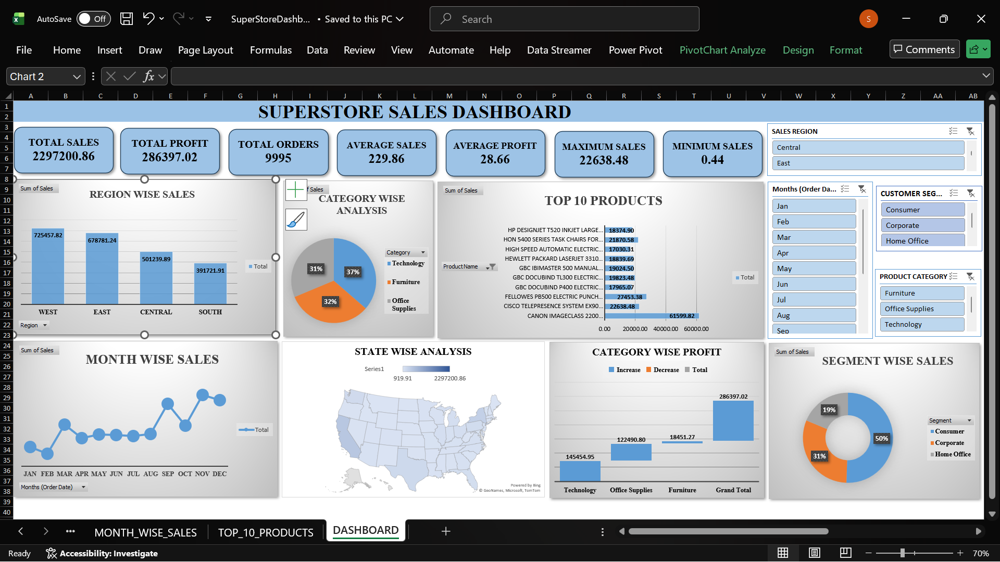

# SuperStore Sales Dashboard \| Excel Data Analytics Project

An interactive sales analytics dashboard built in Microsoft Excel using
the Sample Superstore dataset. The project demonstrates a typical data
analyst workflow: understanding the data, cleaning and formatting
fields, analysing results with PivotTables, building charts, and
assembling an interactive dashboard with KPI cards and slicers.

## Dashboard Preview



> If the preview does not appear, confirm that `dashboard.png` is saved
> inside the `Images` folder and that the filename and capitalisation
> match this path.

## Table of Contents

-   [Project Overview](#project-overview)
-   [Business Objectives](#business-objectives)
-   [Dataset](#dataset)
-   [Tools and Techniques](#tools-and-techniques)
-   [Project Workflow](#project-workflow)
-   [Dashboard Components](#dashboard-components)
-   [Key Insights](#key-insights)
-   [Business Recommendations](#business-recommendations)
-   [Repository Structure](#repository-structure)
-   [How to Use](#how-to-use)
-   [Future Improvements](#future-improvements)
-   [Author](#author)

## Project Overview

The Sample Superstore dataset represents retail orders across product
categories such as Furniture, Office Supplies, and Technology. This
Excel project analyses sales and profit by region, category, customer
segment, month, state, and product.

The dashboard brings the key metrics and charts together on one sheet.
Users can interact with slicers to explore the data, provided the
slicers are connected to the relevant PivotTables.

## Business Objectives

-   Summarise overall sales, profit, and other key performance
    indicators.
-   Compare sales performance across regions and states.
-   Analyse sales and profit across product categories.
-   Explore month-wise sales trends.
-   Identify the top 10 products by sales.
-   Compare sales contributions by customer segment.
-   Enable interactive filtering through slicers.

## Dataset

-   **Dataset:** Sample Superstore retail orders
-   **File:** `01_Data/Sample-Superstore.csv`
-   **Main fields used:** Order ID, Order Date, Ship Date, Ship Mode,
    Segment, State, Region, Category, Sub-Category, Product Name, Sales,
    Quantity, Discount, and Profit.

The dataset is included for reproducibility only if its source and
licence/usage terms permit redistribution. If redistribution is not
permitted, remove the CSV from the public repository and provide a link
to the original source instead.

## Tools and Techniques

-   Microsoft Excel
-   Data inspection and cleaning
-   Handling blank values and duplicate records
-   Date, number, and text formatting
-   PivotTables and PivotCharts
-   KPI cards
-   Slicers and report connections
-   Filled Map chart for state-level analysis
-   Dashboard layout and formatting

## Project Workflow

1.  **Understand the data** --- review the fields and business context.
2.  **Load the dataset** --- bring the CSV into Excel.
3.  **Clean and format** --- inspect blanks and duplicates and set
    appropriate data types and number formats.
4.  **Build KPI cards** --- summarise key metrics.
5.  **Create PivotTables** --- prepare summaries for each business
    question.
6.  **Create charts** --- select chart types suited to comparisons,
    trends, and geographic analysis.
7.  **Add slicers** --- provide filters for region, month, customer
    segment, and product category.
8.  **Assemble the dashboard** --- bring the KPIs, charts, and slicers
    together on the `DASHBOARD` sheet.
9.  **Validate** --- test slicer connections and verify KPI calculations
    before presenting the workbook.

## Dashboard Components

  -----------------------------------------------------------------------
  Component               Visual                  Purpose
  ----------------------- ----------------------- -----------------------
  Total Sales             KPI card                Summarise sales

  Total Profit            KPI card                Summarise profit

  Total Orders            KPI card                Show order count; the
                                                  workbook should use a
                                                  clearly defined
                                                  order-count method

  Average Sales           KPI card                Show average sales
                                                  metric

  Average Profit          KPI card                Show average profit
                                                  metric

  Maximum Sales           KPI card                Show the highest sales
                                                  value

  Minimum Sales           KPI card                Show the lowest sales
                                                  value

  Region-wise Sales       Column chart            Compare sales across
                                                  regions

  Category-wise Analysis  Pie chart               Compare sales share by
                                                  category

  Top 10 Products         Bar chart               Rank products by sales

  Month-wise Sales        Line chart              Explore monthly sales
                                                  patterns

  State-wise Analysis     Map chart               Show geographic sales
                                                  distribution

  Category-wise Profit    Waterfall chart         Show category profit
                                                  contribution

  Segment-wise Sales      Doughnut chart          Compare sales share by
                                                  customer segment
  -----------------------------------------------------------------------

### Slicers

-   Sales Region
-   Month (Order Date)
-   Customer Segment
-   Product Category

Slicer behaviour depends on the PivotTable connections in the workbook.
Test each slicer before relying on it to filter every chart.

## Key Insights

The following are the findings recorded during this project. Recheck
them against the final workbook if the source data or filters have
changed.

-   **Overall performance:** Sales were approximately 2.30 million and
    profit approximately 286 thousand.
-   **Regional performance:** West had the highest recorded sales,
    followed by East, Central, and South.
-   **Category sales:** Technology, Furniture, and Office Supplies had
    relatively similar sales shares.
-   **Category profit:** Technology recorded the highest profit in the
    analysis. Furniture's profit was comparatively low relative to its
    sales.
-   **Customer segments:** Consumer customers contributed about half of
    total sales, with Corporate next and Home Office after that.
-   **Monthly pattern:** September through December showed stronger
    sales, with November recorded as the peak month in the analysis.
-   **Geography:** California was the highest-sales state in the
    recorded analysis.
-   **Top product:** Canon imageCLASS 2200 Advanced Copier was the
    highest-sales product in the recorded Top 10 analysis.

## Business Recommendations

-   Review Furniture pricing, discounting, and costs to understand its
    comparatively low profit.
-   Plan inventory and marketing activity ahead of stronger sales
    months.
-   Investigate the South region's lower sales and identify
    opportunities to improve performance.
-   Compare state-level performance to find opportunities beyond the
    strongest state.
-   Monitor Technology products that contribute strongly to sales and
    profit.

## Repository Structure

``` text
Super Store Project/
├── README.md
├── 01_Data/
│   └── Sample-Superstore.csv
├── Reports/
│   └── SuperStoreDashboard.xlsx
└── Images/
    ├── dashboard.png
    ├── region_wise_sales.png
    ├── category_wise_sales.png
    ├── top_10_products.png
    ├── month_wise_sales.png
    ├── state_wise_analysis.png
    ├── category_wise_profit.png
    └── segment_wise_sales.png
```

Only include screenshot files that you have actually created. If your
workbook or folders have different names, update the paths in this
README to match the actual names.

## How to Use

1.  Download `Reports/SuperStoreDashboard.xlsx`.
2.  Open the workbook in the desktop version of Microsoft Excel for best
    compatibility with PivotTables, slicers, and the map chart.
3.  Open the `DASHBOARD` sheet.
4.  Use the slicers to filter the analysis.
5.  Explore the supporting sheets to review the PivotTables behind the
    charts.

## Future Improvements

-   Add profit-margin and discount analysis by sub-category.
-   Add year-over-year comparisons and a date timeline.
-   Analyse repeat customers and top customers.
-   Recreate the dashboard in Power BI or Tableau.
-   Extend the analysis using SQL and Python.

## Author

**Haish Prithesh Kumar**\
Aspiring Data Analyst \| Excel \| SQL \| Python \| Power BI

-   LinkedIn: [Haish Prithesh
    Kumar](https://www.linkedin.com/in/haish-prithesh-kumar-j/)
-   - GitHub: [Superstore Sales Dashboard](https://github.com/haishprithesh/Superstore-Sales-Dashboard)

------------------------------------------------------------------------

If you find this project useful, feel free to star the repository.
